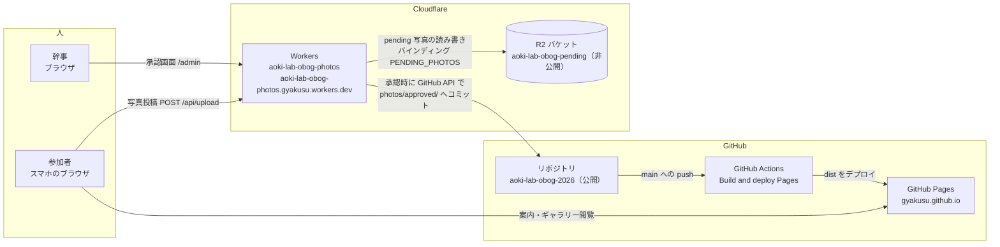
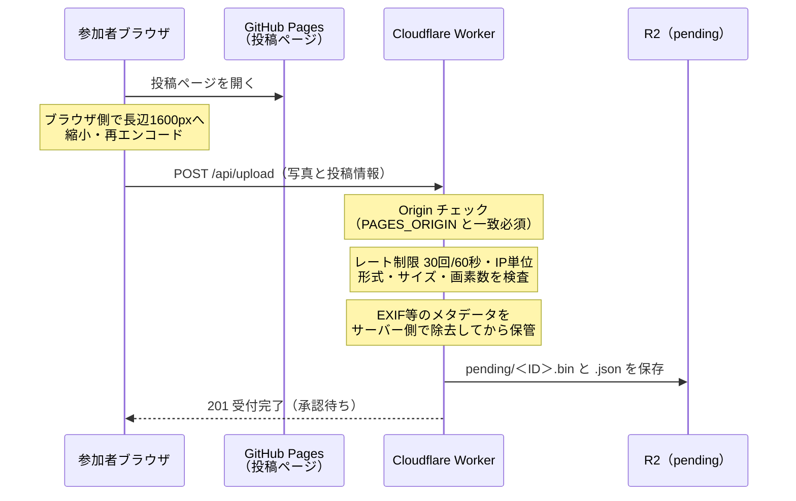
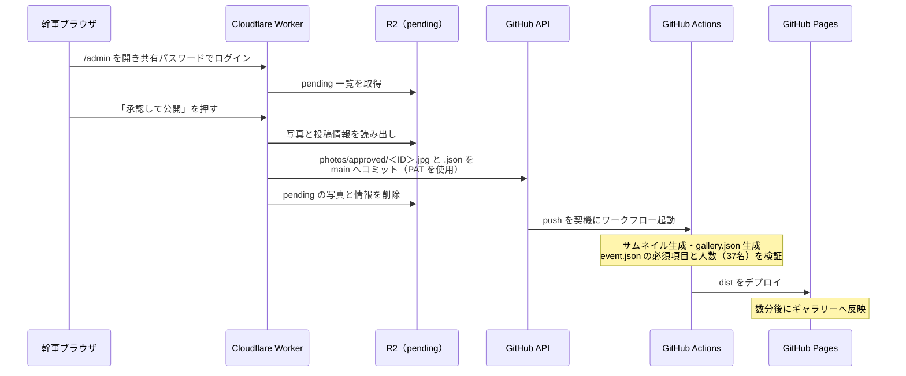
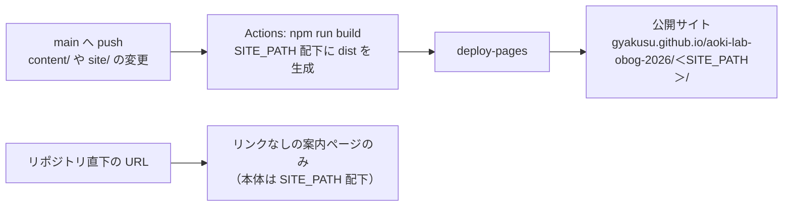

# GitHub と Cloudflare の連携構成

青木研 OB・OG会 情報ハブ（リポジトリ `gyakusu/aoki-lab-obog-2026`）で、GitHub と Cloudflare がどう連携しているかを記録する資料です。
2026年11月1〜2日に構築・検証した時点の構成です。秘密情報の「値」はこの文書には書きません（保管場所だけを示します）。

## 全体像

役割分担は次のとおりです。

- **GitHub**: ソースと公開済み写真の保管場所。GitHub Pages がサイトを配信し、GitHub Actions がビルドとデプロイを担う
- **Cloudflare Workers**: 写真投稿の受け付けと、幹事用承認画面（`/admin`）を提供するサーバーレス API
- **Cloudflare R2**: 未承認（pending）の写真だけを置く非公開ストレージ

ポイント:

- 未承認の写真は R2 にしか存在せず、公開リポジトリには入りません
- 承認された写真だけが Worker 経由でリポジトリにコミットされ、Actions のビルドでギャラリーに載ります
- サイト本体（Pages）は静的配信のみで、投稿の受け付けはすべて Worker が担います

## 写真投稿の流れ

補足:

- 投稿先 URL は `site/config.js` の `UPLOAD_API_URL` で指定します（現在は Worker の URL）。末尾スラッシュは不要で、投稿コードが `/api/upload` を付けます
- メタデータ除去は 2026年11月2日にブラウザ依存をなくすため Worker 側へ移しました。除去できない画像は受け付けません

## 承認と公開の流れ

## サイト更新の流れ（お知らせ・当日案内など）

注意（2026年11月2日の実例）: リポジトリの **Settings → Pages → Build and deployment の Source は「GitHub Actions」** でなければなりません。「Deploy from a branch」のままだと Jekyll ビルド（README のページ）が Actions の生成物を上書きし、本体が 404 になります。

## 連携ポイント一覧（どこに何を設定したか）

| 設定 | 場所 | 内容 |
| --- | --- | --- |
| `UPLOAD_API_URL` | `site/config.js` | Worker の URL `https://aoki-lab-obog-photos.gyakusu.workers.dev` |
| R2 バインディング | `worker/wrangler.toml` | `PENDING_PHOTOS` → バケット `aoki-lab-obog-pending` |
| レート制限 | `worker/wrangler.toml` | `UPLOAD_LIMITER`、30回/60秒（会場 Wi-Fi で IP を共有するため緩め） |
| Worker の変数 | `worker/wrangler.toml` の `[vars]` | `GITHUB_OWNER` / `GITHUB_REPO` / `GITHUB_BRANCH` / `PAGES_ORIGIN`（`https://gyakusu.github.io`） |
| `GITHUB_TOKEN` | Worker Secret（`wrangler secret put`） | fine-grained PAT。対象はこのリポジトリのみ、権限は Contents の Read and write のみ |
| `ADMIN_PASSWORD` | Worker Secret（`wrangler secret put`） | `/admin` の共有パスワード。幹事間でのみ共有 |
| `SITE_PATH` | GitHub Actions Secret（リポジトリ設定） | 公開 URL の末尾パス。値は参加者への共有 URL に含まれますが、この文書には記載しません |
| Pages の公開元 | Settings → Pages | Source = GitHub Actions |

使っていないもの:

- バケット `aoki-obog-photos` と、発行した R2 の S3 互換 API トークン
- （この節以降の記述は初回コミット時点で欠落していたため復元できていません。必要に応じて追記してください）